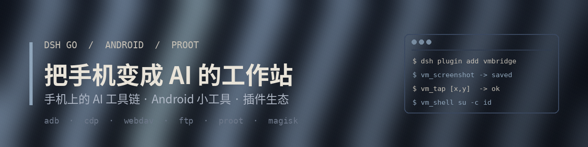

<div align="center">
  
  <br><br>
  <samp>
    <a href="https://github.com/xqe-bkflda/dsh-go-market">插件市场</a> ·
    <a href="https://github.com/xqe-bkflda/awesome-dsh-plugin">插件精选</a> ·
    <a href="https://github.com/xqe-bkflda?tab=repositories">全部仓库</a>
  </samp>
</div>

<br>

<p align="center">
  
</p>

<h3 align="center">把手机变成 AI 的工作站</h3>

<p align="center">
  手机上的 AI 工具链 · Android 小工具 · Proot 折腾流<br>
  <sub>DSH Go 插件作者 · 让 AI 直接操控 Android 虚拟机、浏览器与文件</sub>
</p>

<br>

## 我在做什么

我没有电脑，只有手机。所以所有东西都得在手机上跑起来。

- **DSH Go** 插件生态 —— 给手机端的 AI Agent 装上手脚：操控虚拟机、转发浏览器画面、挂载文件目录
- **Android 原生小工具** —— 纯 Java / Kotlin，APK 越小越好，零第三方依赖
- **Proot + adb + Magisk** —— 在手机里开一台有 root 的 Android 虚拟机

## 主要项目

<table>
<tr><td width="50%" valign="top">

**[dshgo-vmbridge](https://github.com/xqe-bkflda/dshgo-vmbridge)** · ★ AI 操控 Android 虚拟机

让 AI 直接看屏幕、点按钮、敲键盘、跑 root shell、装 APK。
通过 adb 驱动 AndVM 里的 Android 12。

<sub>[查看 →](https://github.com/xqe-bkflda/dshgo-vmbridge)</sub>

</td><td width="50%" valign="top">

**[dshgo-ego-remote](https://github.com/xqe-bkflda/dshgo-ego-remote)** · ★ 手机浏览器当远程桌面

把手机上正在跑的浏览器页面转发成一张能看能点的网页，
电脑/平板打开即用，走同一 WiFi。实测 54 fps。

<sub>[查看 →](https://github.com/xqe-bkflda/dshgo-ego-remote)</sub>

</td></tr>
<tr><td width="50%" valign="top">

**[dshgo-dir-share](https://github.com/xqe-bkflda/dshgo-dir-share)** · ★ 工作区目录挂载到手机

内置 FTP + WebDAV 服务端，MT 管理器直接挂载读写。
纯 Node，零第三方依赖。

<sub>[查看 →](https://github.com/xqe-bkflda/dshgo-dir-share)</sub>

</td><td width="50%" valign="top">

**[netspeed](https://github.com/xqe-bkflda/netspeed)** · ★ 网络测速 + 内存悬浮球

纯 Java 无依赖，APK 69 KB。下载/上传/延迟/抖动，
独立进程省内存。

<sub>[查看 →](https://github.com/xqe-bkflda/netspeed)</sub>

</td></tr>
<tr><td width="50%" valign="top">

**[aplayer-custom](https://github.com/xqe-bkflda/aplayer-custom)** · APlayer 二改版

接入网易云 / 酷狗在线音乐、听歌识曲、批量下载。
Jetpack Compose 写的安卓音乐播放器。

<sub>[查看 →](https://github.com/xqe-bkflda/aplayer-custom)</sub>

</td><td width="50%" valign="top">

**[dsh-go-market](https://github.com/xqe-bkflda/dsh-go-market)** · DSH Go 插件市场

带版本锁定与自动化风险检查的插件目录。

<sub>[查看 →](https://github.com/xqe-bkflda/dsh-go-market)</sub>

</td></tr>
</table>

## 技术栈

<p>
  
  
  
  
  
  
  
  
</p>

## 常用工具链

```bash
# 手机上开一台有 root 的 Android 虚拟机
adb connect 127.0.0.1:<AndVM 调试端口>
adb -s 127.0.0.1:<端口> shell "su -c id"

# 装 DSH Go 插件
dsh plugin --profile web add "$DSH_HOME/dsh-go/plugins/local-vmbridge"

# 无 Gradle 出 APK
./build.sh .
```

## 联系

- GitHub Issues —— 提 bug 和需求，最快
- 插件问题先看各仓库 README 的「前置条件」和「常见问题」

<br>

<p align="center">
  <sub>用 <a href="https://github.com/xqe-bkflda/dsh-go-market">DSH Go</a> 在手机上折腾。</sub>
</p>
